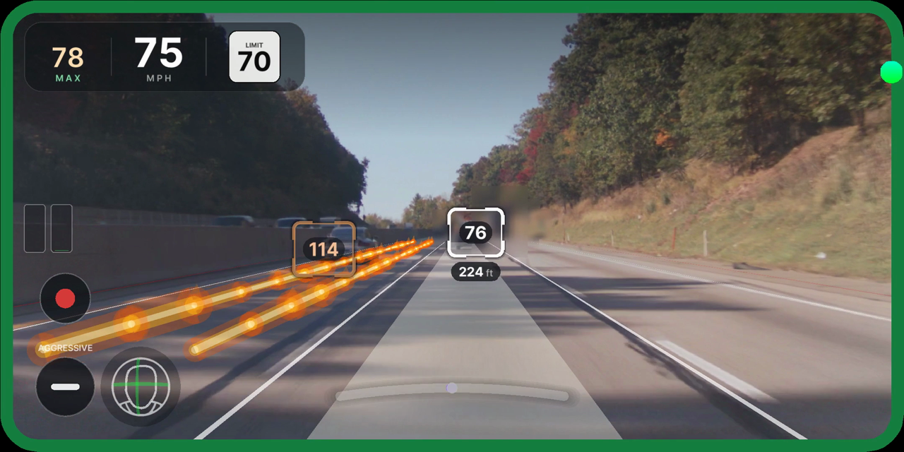

<picture>
  <source media="(prefers-color-scheme: dark)" srcset="docs/media/bogpilot_logo_white.png">
  
</picture>

# BogPilot for legacy Tesla Model S and Model X

openpilot 0.11.2 for Autopilot 1 Model S, Autopilot 1 Model X and Pre-Autopilot Model S, on the comma 3X.

BogPilot is a community fork of FrogPilot, which is a fork of openpilot. It is not a comma product. You are always
responsible for driving: keep your hands on the wheel and your eyes on the road, and be ready to take over at any time.

> [!IMPORTANT]
> **`bogpilot-tesla` is supported and tested on the comma 3X on AGNOS 19.9.**
> Install URL for the comma 3X: `installer.comma.ai/BogPilot/bogpilot-tesla`
>
> **comma 4:** a BogPilot driving screen and menus for the comma 4 are included, but they have never run on a real comma 4.
> They are checked only with automated tests. See the warning below.
>
> **comma 3:** do not install `bogpilot-tesla`. comma does not officially support AGNOS 19.9 on comma 3 hardware.
> For a comma 3 and an AP1 Model S, use the `bogpilot-tesla-0.9.7` branch (AGNOS 10.1):
> `installer.comma.ai/BogPilot/bogpilot-tesla-0.9.7`

> [!WARNING]
> **comma 4 support is untested on real hardware.** The developer does not have a comma 4. If you try it, expect
> problems and report them in GitHub Issues. The supported device is the comma 3X.

*BogPilot on a legacy Model S (replay, signs and plates blurred). Click the picture for the video.*

## Supported cars

| Car | Platform | Steering | Speed control | Road testing so far |
|---|---|---|---|---|
| Model S, Autopilot 1 (2014 to 2016) | `TESLA_AP1_MODELS` | yes | openpilot longitudinal, including engage from a stop; or the car's own cruise (stock TACC) with Disable openpilot Longitudinal Control | Drive tested by the maintainer on this build line, the most tested car |
| Model X, Autopilot 1 (2016) | `TESLA_AP1_MODELX` | yes | openpilot longitudinal is on by default, including engage from a stop; stock TACC is still available with Disable openpilot Longitudinal Control | Drive tested on recent builds, with drive logs, with openpilot steering and with openpilot longitudinal |
| Model S, Pre-Autopilot (2012 to 2014) | `TESLA_PREAP_MODELS` | yes | only with a Comma Pedal. Without a pedal, a pull engages steering only and a double pull arms the car's own cruise | Drive tested on several Pre-AP cars, with drive logs, with and without the Comma Pedal and with the Bosch radar retrofit |
| Model S and Model X, Autopilot 2 | none | no | no | **Not supported.** An AP2 car is never treated as AP1 |

**How the car is found.** AP1 cars have no firmware version rows, so they are recognised by their chassis CAN signature,
and a Model X is told apart from a Model S by its own CAN frames. A Pre-AP Model S is detected from a Comma Pedal with no
Mobileye on the camera bus, or picked in Car Selection (also the way to choose a Pre-AP car without a pedal). Car Selection
and ForceFingerprint can always override detection.

**Starting steering values.** paramsd starts from a steer ratio of 14.0 on the AP1 and Pre-AP Model S and 16.8 on the AP1
Model X, then learns each car's own value. A learned value you already have is kept. The panda steering limits do not
depend on these numbers.

### Optional hardware
- **Comma Pedal (Pre-AP):** needed for openpilot speed control on a Pre-AP car. It must be calibrated while parked
  (Vehicle Settings). A wired but uncalibrated pedal gives steering only.
- **Bosch radar retrofit (Pre-AP):** radar gateway in the panda, donor type and donor VIN settings, Flip Radar, Radar
  Offset, Test Radar and Calibrate Radar. Off by default. Drive tested on Pre-AP cars with the retrofit; final
  confirmation is pending.
- **Retrofitted AP1 stalk (Pre-AP):** detected automatically after you hold two different follow distances for about
  2.5 s each.
- **Air suspension (AP1 Model S and Model X):** Auto Height, see below.

## What's new

This list covers the work since the last update of this branch, newest first. Full notes are in `RELEASES.md`, and
every change from the references is listed in `docs/tesla/DIVERGENCES.md`.

### Latest build
- **Map curve speed holds through short map data gaps.** When mapd briefly stops reporting a curve (for example when it
  switches to the next road segment), the curve point is kept for up to 3 s instead of being released at once, so the car
  no longer speeds up into a curve and then brakes late.
- **Software update button greyed out while onroad**, on the comma 3X and the comma 4. The updater only runs offroad, so
  the button now reads "available when offroad" instead of doing nothing.
- **Steer ratio starting value 14.0 for the AP1 and Pre-AP Model S** (was 15.0), where paramsd settled on real Model S
  drives. The AP1 Model X stays at 16.8.
- **Fewer storage writes:**
  - Learned values and counters now save on the same 10 to 60 s cadence as stock openpilot: curve speed learning every
    60 s and only when it learned something, Tesla trim refinements at most every 60 s, drive stats every 60 s, speed
    limit memory at most every 10 s.
  - The Pre-AP pedal status row reads the car's own message; the pedal heartbeat files are gone.
  - The stalk Experimental Mode toggle saves without blocking the car process.
  - Curve speed data is capped at 5,000 entries; the least recently seen entry is dropped first.
  - Auto Height settings save like a stock toggle (synced to storage), off the UI thread.
  - Map downloads started while driving are limited to 5 Mbit/s, run at the lowest normal priority and stay on cores
    0 to 2, away from the driving processes. Automatic map updates wait until the car is off.
- **Settings writes are never lost.** A setting saved in the background while another save was queued could be dropped;
  it is now always written.
- **Logging resync.** loggerd now resyncs with the video encoder when it rotates to a new segment ahead of it.
- **Pre-AP with the Comma Pedal: no stray wiper sweep.** openpilot cancels the car's own cruise only when it is really on,
  so engaging no longer sends an extra stalk message that could trigger a single wipe with the wipers in Auto.
- **AP1 stalk follow distance:** turning the follow distance ring while engaged no longer raises a Communication Issue
  alert. The personality on screen follows the ring at once and is saved once, 0.3 s after the ring stops.

### AP1 Model X
- openpilot longitudinal is on by default on a detected AP1 Model X, with engage from a stop, the Model S comfort
  features, stalk follow distance, stalk personality sync, Stalk Controls and single pull Speed Limit Control.
  Disable openpilot Longitudinal Control is the single row to go back to stock TACC with openpilot steering.
- Every default setting matches the AP1 Model S. Only the measured steering values, the Model X regen stop numbers and
  the Very Low height below are specific to the Model X.
- Blind spot monitoring as on the Model S: border, lane fill, the passing car effect and Loud Blindspot Alert, and lane
  changes wait for a clear side.
- Dash Cluster Integration as on the Model S: lane lines, engaged state and warnings on the instrument cluster, and
  openpilot's set speed with openpilot longitudinal.
- Steering uses a steer ratio of 16.8 and a steering delay of 0.15 s, measured on a real Model X. Wheelbase 2.965 m.
- Auto Height adds Very Low, the lowest height the Model X touchscreen offers (allowed by the panda only on a Model X).

### All supported cars
- **Curve Speed Control:** one planner slows for camera and map curves on AP1 and Pre-AP, starting earlier and easing out.
  mapd v2 and Map Curve Speed are on by default.
- **Auto Height (AP1 air suspension, off by default):** asks for your Park height when you shift into Park and your Drive
  height when you shift from Park into Drive. The panda allows it only while stopped, never while moving or engaged.
- **Drive Summary** after each drive on the comma 3X home screen: percent of the drive with openpilot steering, distance,
  drive time and percent in Experimental Mode.
- **Map downloads on the device:** pick countries or U.S. states under Navigation > Maps.
- **Driving Model page:** extra models, including comma.ai's Cheddar, can be downloaded while the car is off. Each is
  checked before use and falls back to the stock model, which stays the default. Cheddar has not yet been driven.
- **Tesla Tuning page** (Advanced tuning level): acceleration ramp, comfort regen, stop shaper, curve braking and Pre-AP
  pedal limits, each starting at the car's current value.
- **Trim detection** on AP1 and Pre-AP: single or dual motor and Performance are read from the car. Display and comfort
  braking only.
- AP1 Model S and Model X openpilot longitudinal uses a 0.35 s actuator delay; Pre-AP stays at 0.4 s.
- Most settings can be changed while driving, as in FrogPilot 0.9.7. Settings the car reads only at start ask for a reboot;
  resets, downloads and pedal calibration still need Park or the car off.
- Holding the stalk tip in the first detent changes the set speed by 1 every 0.2 s after a short pause, like native AP1
  TACC. The deep detent steps to the next 5.
- AP1 steering recovers from temporary power steering faults (code 4 at any speed above about 0.7 mph, and a latched
  code 7) without a power cycle.
- New panda firmware (updates itself on the first start after updating): steering commands are limited to a safe
  cornering force on AP1 and Pre-AP and to ±360° of wheel angle, plus the Auto Height ride height rules above. Pre-AP
  steering requests stay within 20° of where the wheel is.

## Install

Requirements: a comma 3X on AGNOS 19.9 and a harness for your car.

1. On the comma 3X setup screen, choose custom software and enter:
   `installer.comma.ai/BogPilot/bogpilot-tesla`
2. After install, check that Settings > Software shows branch `bogpilot-tesla`.
3. Connect the harness and start the car. Vehicle settings appear once the car is detected.

The 0.9.7 / AGNOS 10.1 line stays on branch `bogpilot-tesla-0.9.7`. It has no shared history with this tree. Do not install
it on a comma 3X that is already on AGNOS 19.9.

## Features and defaults

A short list of BogPilot specific behaviour. Every setting has help text on the device.

- **Pedal gauge** (Pedals on Screen, default On): three bars for brake, regen and acceleration while openpilot
  longitudinal is active. Display only.
- **Override Sensitivity** (default 2): how hard you push the wheel to take over steering, 2.5 Nm at level 1 down to
  1.5 Nm at level 5. The power steering hands on flag always counts as a takeover; panda steering limits do not change.
- **Stalk hold for Experimental Mode** (default 1.23 s): with openpilot longitudinal, a long stalk pull while engaged,
  or a long push while disengaged, switches between Chill and Experimental once.
- **Blind spot display** (AP1 Model S and Model X): Blind Spot Lane Fill and Blind Spot Border, both on by default.
- **Driver Camera in Reverse** (default On on a fresh install).
- **Experimental Mode on a fresh install:** the warning counts as accepted and driving starts in Chill. Updating changes
  nothing. Experimental Mode is still alpha.
- **Longitudinal profiles from 0.9.7** on AP1 and Pre-AP: applied once at start up without overwriting anything you
  changed. Turning Longitudinal Tuning off returns to the stock limits.
- **Camera View** (default Auto), **Confidence ball** (default On), **Sidebar** temperature, Power, GPU and MODELD
  readouts.

## Testing status

Read this before you drive.
- **AP1 Model S:** the most tested car. The maintainer drives it on this build line and reports the latest build working
  well.
- **AP1 Model X:** drive tested on recent builds with drive logs, with openpilot steering and with openpilot
  longitudinal. Some Model X comfort and stop values are still provisional.
- **Pre-AP Model S:** drive tested on several Pre-AP cars with drive logs, with and without the Comma Pedal. The Bosch
  radar retrofit is drive tested on Pre-AP cars that have it; final confirmation is pending.
- **comma 4:** never run on real hardware.
- Each build is checked with the openpilot and opendbc test suites, including all 48 panda safety test files, before
  release.

## Privacy

BogPilot does not register with comma servers and does not upload driving data to comma by default.

## Credits

- comma.ai openpilot (MIT).
- FrogPilot by FrogAi (James) and contributors (MIT); BogPilot forks FrogPilot's work.
- NotAutopilot (NAP, MIT): the Pre-AP pedal longitudinal controller (VirtualDAS, pedal feedback and authority, the
  feedforward table), the radar donor VIN and the Pre-AP Bosch radar gateway are derived from NAP, some files copied with
  small changes and others adapted. NAP is also the reference for Pre-AP engagement and panda safety.
- Tinkla / BogGyver openpilot (MIT): CAN definitions, Model X fingerprints and rate tables, a few CAN helpers adapted
  in form, and the reference for the AP1 cluster, pedal calibration and radar behavior.
- BogPilot 0.9.7 (`bogpilot-tesla-0.9.7`): Pre-AP CAN definitions and the first Pre-AP port.
- mapd map data by pfeiferj (MIT).
- Beta tester **IRIT-able** (GitHub, fork `github.com/IRIT-able/bogpilot-openpilot`) contributed Pre-AP fixes.
  On Nov 5 2026 they fixed the Comma Pedal sensor bit layout (GAS_SENSOR state and counter nibbles), engaging only on a stalk pull, and re-arming on a new pull. BogPilot took those fixes in; the sensor layout and the panda re-arm on a new pull are still in this code, while the engagement logic has since been rewritten.
  On Nov 17 2026 they contributed five more Pre-AP fixes, which BogPilot merged with only small wording changes: the first pull engages without "Press Set to Engage", the Steering only banner times out, the radar status shows which fault bits are set, the Donor VIN entry row, and a fix for a stall on the first engage.
  Their drive testing and drive logs also guided other Pre-AP fixes. Thank you.
- Thanks to all the Model X and Pre-AP drivers who tested builds and shared their drive logs.

Lineage: BogPilot is forked from FrogPilot's work (FrogAi and contributors, MIT), which is itself a fork of openpilot (MIT,
Comma.ai, Inc.), and adds legacy Tesla support. Thank you to the FrogPilot team for their brilliant work. Which legacy
Tesla files come from NAP or Tinkla / BogGyver, and how, is listed in `docs/bogpilot_c3x_provenance.md`. BogPilot is not
a comma product and does not use the openpilot trademark as a product name for modified safety builds.

MIT Licensed

openpilot is released under the MIT license. Some parts of the software are released under other licenses as specified.

Any user of this software shall indemnify and hold harmless Comma.ai, Inc. and its directors, officers, employees, agents, stockholders, affiliates, subcontractors and customers from and against all allegations, claims, actions, suits, demands, damages, liabilities, obligations, losses, settlements, judgments, costs and expenses (including without limitation attorneys’ fees and costs) which arise out of, relate to or result from any use of this software by user.

**THIS IS ALPHA QUALITY SOFTWARE FOR RESEARCH PURPOSES ONLY. THIS IS NOT A PRODUCT.
YOU ARE RESPONSIBLE FOR COMPLYING WITH LOCAL LAWS AND REGULATIONS.
NO WARRANTY EXPRESSED OR IMPLIED.**

